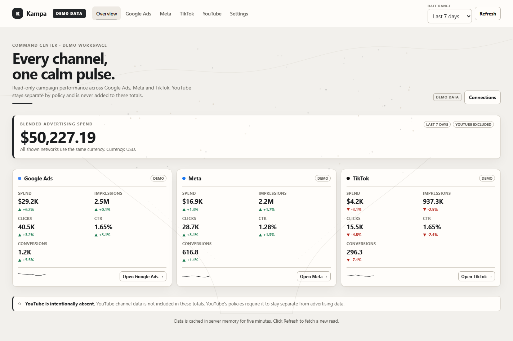

# Kampa

**Your ad buddy that never sleeps.**



Kampa is a read-only dashboard for Google Ads, Meta, TikTok, and YouTube metrics. It exists because performance reporting is usually split across four different interfaces, each with its own metric names, date controls, and export format. Kampa puts the operating view in one place and keeps provider credentials on the server instead of in the browser.

**Project page:** <https://dexilio13-ui.github.io/adpulse/>  
**Repository:** <https://github.com/dexilio13-ui/adpulse>

> **Live-account status:** Demo mode and normalization are tested. The live clients are implemented but have not been verified against real provider accounts. Real response shapes, permissions, API versions, and quota behavior remain **UNVERIFIED** until tested with live credentials. See [docs/API_NOTES.md](docs/API_NOTES.md).

## Why I built it

I work where performance marketing meets engineering, and the reporting loop I care about is simple: where did spend go, what did it return, and which network needs attention next? The metrics I check first are spend, impressions, clicks, CTR, CPC, CPM, conversions, conversion value, and cost per result, at account, campaign, ad set or ad group, ad, and keyword level.

The tools I had access to were either tied to one ad network or required a spreadsheet reconciliation before the numbers were comparable. Kampa is my attempt to keep each platform's reporting model intact while putting the operating view in one place: Google micros converted once, Meta action types kept explicit, TikTok report levels preserved, and YouTube isolated because its policy requires it.

## AI assistance and ownership

This project was built with AI assistance, and I would rather state that plainly than present it as entirely hand-written. I used Codebuff as an implementation partner. I set the product brief and scope: four ad networks, read-only access, credentials on the server, demo data flowing through the same normalization path as live data, YouTube isolated by construction, and no blended total across different currencies. I reviewed the interface at desktop and 360 px and accepted the release checks.

AI helped write and review code, tests, and documentation. The decisions I present as mine are recorded in [docs/DECISIONS.md](docs/DECISIONS.md), and the verification record — including what was not tested — is in [docs/CHECKLIST.md](docs/CHECKLIST.md).

## What is included

- **Overview** — blended advertising spend, per-network KPIs, comparison deltas, and a YouTube exclusion notice. A total is shown only when every connected network reports the same currency.
- **Google Ads** — Search, PMax, Demand Gen, Shopping, and Video views; campaigns, ad groups, ads, keywords, search terms, products, and asset groups; a runtime-verified field catalog; account currency and micros/percent normalization.
- **Meta** — Facebook and Instagram views; account, campaign, ad set, and ad levels; Insights metrics, campaign objects, placement breakdown, column selection, CSV export.
- **TikTok** — advertiser, campaign, ad group, and ad levels; report types; isolated public Ad Library view with a separate approval gate.
- **YouTube** — channel and video analytics in a strictly isolated workspace; no cross-network totals, no CSV export, no disk persistence, memory-only server cache, and a disconnect/delete flow.
- **Settings** — masked secrets, encrypted server-side settings, demo/live switch, timezone, API versions, connection tests, danger zone.

Accessibility, motion, CSP, and custom-cursor implementation notes are in [docs/DECISIONS.md](docs/DECISIONS.md).

## Requirements

- Node.js 20 or newer (tested on Node 24.16.0)
- npm
- A modern browser

## Quick start

### Windows: one click

Double-click **`start.bat`**. It checks Node.js, installs dependencies when needed, creates `.env.local` with a generated `APP_SECRET`, picks the first free local port, starts the server, and opens the dashboard.

### Manual

```bash
npm install
cp .env.example .env.local
```

Generate an application secret and put it in `.env.local`:

```bash
node -e "console.log(require('crypto').randomBytes(32).toString('base64url'))"
```

```dotenv
APP_SECRET=the-generated-value
```

Then run:

```bash
npm run dev
```

Open <http://localhost:3000>. Demo mode is on by default, so the dashboard is usable immediately. Settings cannot be saved until `APP_SECRET` is present.

### Production

```bash
npm run verify
npm start
```

`npm run verify` runs lint, type checking, the test suite, a production build, and a secret scan of the built browser bundle.

If `APP_PASSWORD` is enabled, serve Kampa over HTTPS. The session cookie is `HttpOnly`, `SameSite=Strict`, and `Secure` in production; a plain-HTTP deployment on a remote host will not receive the cookie.

## Configuration

| Variable | Required | Purpose |
| --- | --- | --- |
| `APP_SECRET` | To save settings | Encrypts `data/settings.enc.json` with AES-256-GCM and signs the optional session cookie. Losing or changing it makes existing stored settings unreadable. |
| `APP_PASSWORD` | No | Enables the password gate. The server checks the password; the browser receives a signed, `HttpOnly` session cookie valid for seven days. |
| `GOOGLE_ADS_API_VERSION` | No | Google Ads API version. Default `v26`. |
| `META_API_VERSION` | No | Meta Graph API version. Default `v26.0`. |
| `TIKTOK_API_VERSION` | No | TikTok Marketing API version. Default `v1.3`. |
| `META_ASYNC_ENABLED` | No | Set to `true` only for large Meta accounts that need asynchronous Insights jobs. Off by default. Experimental. |
| `TIKTOK_ADLIB_ENABLED` | No | Set to `true` only after TikTok approves Commercial Content API research access. Live Ad Library calls are refused otherwise. |
| `KAMPA_SETTINGS_FILE` | No | Overrides the encrypted settings path. Defaults to `data/settings.enc.json`. |

Never prefix a secret with `NEXT_PUBLIC_`. The browser only receives masked values showing the last four characters.

## Connecting live accounts

Kampa does not implement an OAuth callback flow. Obtain refresh/access tokens from each provider out of band, then paste them into Settings:

- **Google Ads** — developer token, OAuth client ID/secret, refresh token created with `https://www.googleapis.com/auth/adwords`. A manager-account login customer ID is optional. Customer IDs are digits only.
- **Meta** — a long-lived user or system-user access token with `ads_read` (and `business_management` only if account listing requires it), plus ad account IDs.
- **TikTok Marketing** — app ID/secret and an advertiser access token with reporting and object-read access. Advertiser IDs are digits only.
- **YouTube** — OAuth client ID/secret and a refresh token with `youtube.readonly` and `yt-analytics.readonly`. Add `yt-analytics-monetary.readonly` only for a monetized channel, then enable the monetized switch.
- **TikTok Ad Library** — separate Commercial Content API approval and client credentials/token. Also set `TIKTOK_ADLIB_ENABLED=true`.

When demo mode is on, no provider API is called, regardless of saved credentials.

## Security model

- All provider traffic goes through `apiFetch` in `lib/http.ts`, which calls `assertAllowed` before opening a socket.
- The allowlist is exact: HTTPS only, `GET`/`POST` only, fixed hosts and path patterns. Only OAuth exchanges/revocation, Google Ads `searchStream` and field-metadata search, Meta asynchronous report jobs, and TikTok Ad Library research calls may use POST. See [lib/allowlist.ts](lib/allowlist.ts).
- `tests/allowlist.test.ts` fails if the endpoint set changes without review, and verifies write methods and unknown hosts are refused.
- No provider authorization header or request body is logged.
- Settings are written atomically with mode `0600` to an AES-256-GCM envelope. `data/` and `.env*` are gitignored.
- Mutating app routes reject cross-origin browser requests via an origin/`Sec-Fetch-Site` guard. The password endpoint rate-limits repeated failures per client for one minute.
- Browser security headers, CSP, ARIA-tab behavior, custom-cursor rules, and reduced-motion handling are documented in [docs/DECISIONS.md](docs/DECISIONS.md).
- `scripts/scan-secrets.mjs` scans `.next/static` for configured secret values and common token shapes without printing any secret.

## Project layout

```text
start.bat            One-click Windows launcher
app/                 Next.js shell, privacy page, and API routes
lib/allowlist.ts     Reviewed read-only endpoint set
lib/http.ts          Allowlisted fetch, timeouts, retries, typed errors
lib/clients/         Google Ads, Meta, TikTok, YouTube, OAuth clients
lib/normalize/       One normalization contract for demo and live data
lib/demo.ts          Deterministic demo fixtures
lib/data.ts          Data service, caches, overview currency guard
lib/settings.ts      Encrypted settings and secret masking
vanilla/             Browser ES modules: router, views, charts, canvas, CSS
tests/               Vitest policy, crypto, normalization, catalog, auth tests
docs/                API notes, plan, decisions, checklist, static project page
```

React only mounts the vanilla application. All dashboard rendering is in `vanilla/`; the browser never receives provider secrets.

## Scripts

| Command | What it does |
| --- | --- |
| `start.bat` | One-click local startup on Windows |
| `npm run dev` | Development server |
| `npm run lint` | ESLint |
| `npm run typecheck` | `tsc --noEmit` |
| `npm test` | Vitest suite |
| `npm run build` | Production build |
| `npm start` | Serve the production build |
| `npm run scan:secrets` | Scan built static assets for secrets |
| `npm run verify` | All of the above, in order |

## Documentation

- [API notes and unverified items](docs/API_NOTES.md)
- [Implementation plan](docs/PLAN.md)
- [Architecture decisions](docs/DECISIONS.md)
- [Verification checklist](docs/CHECKLIST.md)
- [Build report](REPORT.md)
- [Privacy page](app/privacy/page.tsx) at `/privacy`

## Known limitations

- Live provider integrations are **not verified end to end** against real accounts. Treat them as reviewed implementations awaiting credentials.
- Meta asynchronous jobs and TikTok Ad Library are experimental/gated. Async Meta polling can hold a request for about a minute.
- TikTok Marketing and Ad Library use different API hosts and access approvals; Ad Library data is transparency data only and is never mixed with performance data.
- YouTube analytics remain separate by policy and construction. They are absent from Overview, exports, persisted data, and logs; only a memory cache holds them for the life of the server process.
- Provider quotas and rate limits are not hard-coded. The client respects `Retry-After` up to 60 seconds and retries safe requests, but no provider-specific quota budget is guaranteed.
- The hand-written vanilla UI bundle is 28.3 KB gzipped in the verified build, within the 150 KB target. Next.js shared framework chunks are additional and are not part of that budget.
- There is no built-in OAuth callback, scheduled refresh, multi-user account model, or background job runner.

## License

MIT. See [LICENSE](LICENSE).
